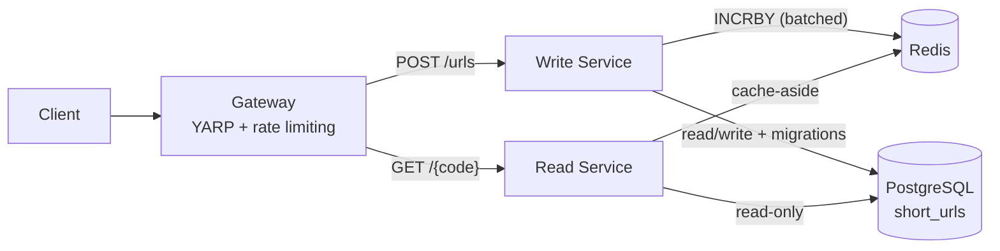

# Architecture

How the Bit.ly-style design in [`system-design.md`](system-design.md) is implemented in .NET.

## Overview



| | Write Service | Read Service |
|---|---|---|
| Container | `write-service` | `read-service` |
| Endpoint | `POST /urls` | `GET /{shortCode}` |
| Use cases | `CreateShortUrlCommand`, `DeleteExpiredShortUrlsCommand` | `GetOriginalUrlQuery` |
| Postgres | Read/write, **owns the schema and migrations** | Read-only (`NoTracking`, read-only DB user) |
| Redis | Global counter | Cache `url:{short_code}` |
| Background job | Expired-URL cleanup | — |

Both services follow Clean Architecture (`Api → Infrastructure → Application → Domain`) and share only `UrlShortener.Domain` (the shared kernel) and `UrlShortener.BuildingBlocks`. Architecture tests (NetArchTest) fail if either service references the other.

## Shared database: a conscious trade-off

Both services use the same `short_urls` table, as in the system design. A database per service would mean duplicating the data plus an event pipeline to keep the copies in sync, which is more complexity than this problem needs.

- The Write Service owns the schema and the migrations.
- The Read Service maps the same table with its own `ReadDbContext` and has no migrations.
- The Read integration tests build the schema from the Write migrations, so any mismatch breaks a test instead of production.

**Table `short_urls`**

| Column | Type | Notes |
|---|---|---|
| `short_code` | `varchar(30)` | **PK** (B-tree index + uniqueness) |
| `original_url` | `text` | No index (no dedup) |
| `created_at` | `timestamptz` | |
| `expires_at` | `timestamptz NULL` | Indexed for cleanup |
| `created_by` | `text NULL` | Auth is out of scope |

## Short codes

### Generated codes
- Pipeline: **counter ID → reversible permutation → base62, left-padded to exactly 7 characters**.
- Code space `[0, 62^7)` ≈ 3.52 trillion. The allocator fails loudly if the counter goes beyond it.
- The permutation is a **bijection on `[0, 62^7)`**: an affine map `(id * A + B) mod 62^7` with `A` coprime to `62^7` (not divisible by 2 or 31), or a Feistel network with cycle-walking. The keys are secrets from configuration.
- Result: codes are not sequential or guessable, are always 7 characters long and **never collide**.
- Required tests: round-trip `Decode(Encode(x)) == x`, always 7 characters, and no duplicates over a large sample range.

### Counter batching
Each Write instance reserves 1000 IDs at a time with Redis `INCRBY` and hands them out locally. If an instance dies, the unused IDs in its batch are lost, which is acceptable: we need uniqueness, not continuity. The DB primary key is the final safety net.

### Custom aliases
- Length **8–30**, characters `[A-Za-z0-9_-]`, **case-sensitive**.
- Generated codes are 7 characters and aliases are ≥ 8, so **the two can never collide by design**.
- Reserved words are rejected (case-insensitive): `urls`, `api`, `health`, `metrics`, `openapi`, `scalar`, `swagger`, `admin`, `static`. The list lives in the Domain.
- An alias that is already taken → `409`. A unique violation on insert is mapped to `409`, never `500`.

### Deduplication
None. Every `POST /urls` creates a new code, so each code keeps its own expiration and alias.

## Expiration

- The Read Service checks `IsExpired(now)` → `410 Gone`.
- The cache TTL is `min(defaultTtl, expiresAt - now)`, so the cache never outlives the URL.
- The Write Service runs a `BackgroundService` that deletes expired rows in batches. After cleanup, the code returns `404` instead of `410`, which is acceptable.

## Gateway

- YARP routes `POST /urls` → `write-service` and `GET /{code}` → `read-service`.
- Rate limiting (`Microsoft.AspNetCore.RateLimiting`) is partitioned per client IP and applies only to `POST /urls`. Over the limit it returns `429` + `Retry-After`.
- Forwarded headers are configured so the real client IP is used.

## Application layer: CQRS without MediatR

```csharp
public interface ICommandHandler<in TCommand, TResult> { Task<Result<TResult>> Handle(TCommand command, CancellationToken ct); }
public interface IQueryHandler<in TQuery, TResult>     { Task<Result<TResult>> Handle(TQuery query, CancellationToken ct); }
```

Cross-cutting concerns are decorators registered in DI:
- `LoggingDecorator` (BuildingBlocks): structured `ILogger` message templates.
- `ValidationDecorator` (Write Service): runs FluentValidation and returns a validation-error `Result` → `400`.

## Observability (OpenTelemetry)

- Configured once in `ServiceDefaults`. Every Api calls `builder.AddServiceDefaults()`.
- **Traces** → OTLP → **Jaeger**: ASP.NET Core, HttpClient (gateway → services), Npgsql/EF Core, StackExchange.Redis.
- **Metrics** → OTLP → **Prometheus** (OTLP receiver): runtime + ASP.NET Core metrics, plus `Meter("UrlShortener")`:

  | Metric | Service | Tags |
  |---|---|---|
  | `urls_created` | write | `custom_alias` true/false |
  | `counter_batches_reserved` | write | |
  | `expired_urls_deleted` | write | |
  | `redirects` | read | `outcome`: found / not_found / expired |
  | `cache_hits`, `cache_misses` | read | |

- The `service.name` resource attribute is `gateway`, `read-service` or `write-service`.
- Logs use `ILogger` with message templates. No Serilog.
- OpenAPI + Scalar are exposed only in the Development environment.
